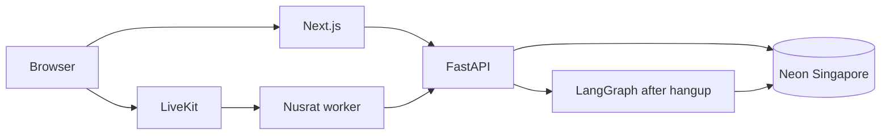

# ByteVoice Bangla

A 24/7 Bangla-speaking receptionist for a dental clinic. The demo clinic is **StrategyByte Dental Care** in Dhanmondi, Dhaka. The agent is **Nusrat**.

A reviewer opens the landing page, talks to Nusrat in the browser, books an appointment in Bangla, hangs up, signs into the portal, and within a minute or two sees the call, a timestamped transcript, the extracted patient, and the appointment.

| | |
| --- | --- |
| Landing | `https://<your-vercel-app>` |
| Portal | `https://<your-vercel-app>/bn/portal` |
| Repo | this repository |
| Video | add a short recording of one booking after the first live call |

## Reviewer login

Seeded from the API environment. The values in `.env.example` are demo-only:

| Role | Email | Password |
| --- | --- | --- |
| admin | `reviewer@strategybyte.demo` | `ReviewerDemo!2026` |
| staff | `staff@strategybyte.demo` | `StaffDemo!2026` |

Change both before any public deploy. The seed does not reset a password that already exists.

## What you are looking at



1. The hero button asks for the microphone, then `POST /api/livekit/token` (5 requests per minute per IP).
2. FastAPI inserts a `calls` row and returns a room token. The token dispatches the worker named `bytevoice`.
3. Nusrat greets in Bangla, asks one thing at a time, and uses tools for hours, slots, booking, reschedule, cancel, and callbacks. She does not invent clinic facts or give medical advice.
4. Final turns stream to `POST /internal/calls/{id}/turns`.
5. Hangup calls `POST /internal/calls/{id}/end`. LangGraph then extracts, validates, summarises, and translates. A signed LiveKit `room_finished` webhook is the fallback if the worker dies first.
6. The portal lists the call, and the detail page shows confidence, the appointment, both summaries, and the transcript in Bangla or English.

## Why these providers

| Piece | Choice | Why |
| --- | --- | --- |
| Realtime media | LiveKit Cloud | Browser call, agent dispatch, barge-in, transcription, optional egress. No BD number required for the demo. |
| STT | OpenAI `gpt-4o-mini-transcribe` (`bn`) | Same API key as the live model, and it works where Deepgram cannot be created. A prompt keeps words like "scaling" and "root canal" in English. Google `bn-BD` is the fallback when Google credentials exist. |
| TTS | OpenAI `gpt-4o-mini-tts`, voice `coral` | Same API key as the live model. The voice is a warm female tone, with an instruction to speak Dhaka Bangla. Google Bengali TTS is the fallback when credentials exist. |
| Live LLM | gpt-4o-mini | Fast enough for a voice turn, with a low token cap. |
| After the call | LangGraph | Extraction and translation are slow. They must not sit in front of her reply. |
| Database | Neon Postgres, AWS `ap-southeast-1` | Closest managed Postgres region to Bangladesh. |
| API + worker | Railway, two services | Both are long-running Python processes. |
| Web | Vercel | Next.js landing and portal. |

More of the reasoning is in [docs/decisions.md](docs/decisions.md). The table shapes are in [docs/schema.md](docs/schema.md). The deploy picture is in [docs/architecture.md](docs/architecture.md).

## Validation

Pure functions in `services/api/app/domain`, covered by pytest:

- Bangla digits `০-৯` become `0-9`. Spaces and dashes are stripped.
- A mobile number must match `^01[3-9]\d{8}$`. It is stored as `+8801XXXXXXXXX`.
- Relative days (`আগামী রবিবার`, `পরশু সকালে`, `next Sunday evening`, `রাত ৭টা`) resolve in `Asia/Dhaka`.
- Friday, holidays, past times, and anything outside 10:00–20:00 are rejected with a Bangla line Nusrat can say.
- Names keep a Bangla form and a title-cased English form. The model does not invent the English spelling during the call; the post-call step fills it when it can.
- Confidence under 0.65, or a field that fails those rules, sets `needs_review` on the portal.

The live model is told to copy `slot_start_iso` from the availability tool. The API checks that slot again before insert. Two active bookings for the same doctor and slot cannot both commit.

## Latency

The worker logs `voice_to_voice_ms`: time from the caller stopping to Nusrat starting to speak. That includes turn detection, the model, and the first TTS audio. It is a log line, not a guarantee.

What keeps it short: Silero is preloaded, replies are capped around two sentences, tools hit FastAPI rather than a second LLM, and LangGraph waits until the call is over. OpenAI TTS returns a full clip rather than a stream, so the first syllable can land a little later than a streaming voice. On a cold worker or a distant region this can miss 1.2s. Measure it from the agent log after a real call.

## Repository

```
apps/web            Next.js landing + portal
services/api        FastAPI, Alembic, LangGraph
services/agent      LiveKit worker (Nusrat)
packages/shared     TypeScript types shared with the web
docs                architecture, schema, decisions
```

Clinic rules (phone, calendar, outcome) do not import the database. The voice worker does not import FastAPI; it calls it. The portal does not talk to Postgres; it talks to the API with the reviewer's cookie.

## Local setup

Requirements: Python 3.11+, Node 20+, Docker (for Postgres only).

```bash
docker compose up -d db
cp services/api/.env.example services/api/.env
cp services/agent/.env.example services/agent/.env
cp apps/web/.env.example apps/web/.env.local

cd services/api
python -m venv .venv
# Windows: .venv\Scripts\activate
# macOS/Linux: source .venv/bin/activate
pip install -e ".[dev]"
alembic upgrade head
python -m app.seed
uvicorn app.main:app --reload --port 8000

cd apps/web
npm install
npm run dev

cd services/agent
python -m venv .venv
pip install -e .
python main.py download-files
python main.py dev
```

`scripts/bootstrap.sh` does the database half. Tests that do not need Postgres:

```bash
cd services/api && python -m pytest
```

Open `http://localhost:3000`. The landing is Bangla first; the navbar switches to English. Portal: `http://localhost:3000/bn/portal/login`.

Without LiveKit keys the page still loads and the call button explains that voice is not configured. The seeded calls are enough to click through the portal.

## Environment

Never commit filled `.env` files. Set the same names on Vercel (web) and Railway (api, agent).

### API `services/api/.env`

| Name | Purpose |
| --- | --- |
| `APP_ENV` | `local` or `production`. Production refuses a `dev-` JWT or service token. |
| `DATABASE_URL` | `postgresql+asyncpg://...` Neon URL should include `?ssl=require`. Region `ap-southeast-1`. |
| `JWT_SECRET` | Signs the portal cookie token. |
| `JWT_EXPIRE_MINUTES` | Default 720. |
| `SERVICE_TOKEN` | Shared with the worker. Sent as `X-Service-Token`. |
| `CORS_ORIGINS` | Comma-separated web origins. |
| `LIVEKIT_URL` | `wss://...livekit.cloud` |
| `LIVEKIT_API_KEY` / `LIVEKIT_API_SECRET` | Token minting, dispatch, webhook verification. |
| `LIVEKIT_AGENT_NAME` | Must match the worker. Default `bytevoice`. |
| `OPENAI_API_KEY` | Post-call extraction, summary, translation. |
| `SEED_ADMIN_EMAIL` / `SEED_ADMIN_PASSWORD` | Reviewer admin. |
| `SEED_STAFF_EMAIL` / `SEED_STAFF_PASSWORD` | Staff user. |
| `SEED_ON_START` | `true` runs the idempotent seed on API boot. |
| `TOKEN_RATE_LIMIT` / `TOKEN_RATE_WINDOW_S` | Default 5 per 60 seconds per IP. |
| `R2_ENABLED` | `false` skips recording. |
| `R2_ACCESS_KEY_ID` / `R2_SECRET_ACCESS_KEY` / `R2_BUCKET` / `R2_ENDPOINT` | S3-compatible egress target. |
| `R2_PUBLIC_BASE_URL` | Public base used when the egress webhook stores `recording_url`. |

### Agent `services/agent/.env`

| Name | Purpose |
| --- | --- |
| `LIVEKIT_URL` / `LIVEKIT_API_KEY` / `LIVEKIT_API_SECRET` / `LIVEKIT_AGENT_NAME` | Same project as the API. |
| `API_BASE_URL` | FastAPI base, no trailing path. |
| `SERVICE_TOKEN` | Same as the API. |
| `OPENAI_API_KEY` | Live gpt-4o-mini, Bangla speech-to-text, and Bangla speech. |
| `OPENAI_STT_MODEL` | Default `gpt-4o-mini-transcribe`. |
| `OPENAI_STT_LANGUAGE` | Default `bn`. |
| `OPENAI_TTS_MODEL` | Default `gpt-4o-mini-tts`. |
| `OPENAI_TTS_VOICE` | Default `coral`, a warm female voice told to speak Dhaka Bangla. |
| `TTS_PROVIDER` / `STT_PROVIDER` | `auto` uses OpenAI for both. `google` needs a service account. |
| `GOOGLE_APPLICATION_CREDENTIALS` | Turns on the Google STT/TTS fallback. |
| `GOOGLE_TTS_VOICE` | Default `bn-IN-Wavenet-A`. |

### Web

| Name | Purpose |
| --- | --- |
| `API_URL` | Server-side FastAPI origin, for example `https://<api>.up.railway.app`. Not a public browser URL. |

## Deploy

**Neon.** Create a Postgres database in AWS Singapore. Put the pooled `postgresql+asyncpg` URL in the API service.

**Railway, API.** Root `services/api`, Dockerfile. The image runs `alembic upgrade head` then uvicorn on `$PORT`. Set `SEED_ON_START=true` for the first boot so the clinic, reviewer, and sample calls exist. Set `APP_ENV=production` and real secrets.

**Railway, agent.** Root `services/agent`, Dockerfile. Start command is `python main.py start`. The worker must stay running or the hero call times out after 10 seconds. `LIVEKIT_AGENT_NAME` must be `bytevoice` on both services.

**LiveKit Cloud.** Create a project. Copy the URL, key, and secret to both Railway services. Point the webhook at `https://<api>/webhooks/livekit` and let LiveKit sign it. The API rejects a bad signature.

**Vercel.** Project root `apps/web`. Set `API_URL` to the Railway API. The landing and portal are the same deployment. Locale prefix: `/bn` and `/en`.

**Optional R2.** Create a bucket, an API token with object write, and a public base URL if the portal should play audio. Leave `R2_ENABLED=false` until that exists.

After deploy, place five or six real browser calls, then confirm each one in the portal: status, transcript with speaker and time, patient phone in E.164, and the appointment on the week calendar.

## Known limits

- This demo is a browser call. There is no Bangladesh phone number and no SIP trunk.
- Recording works only when R2 is filled in, and playback needs `R2_PUBLIC_BASE_URL`. Otherwise the transcript is the record.
- Google STT/TTS are wired as a fallback. They do nothing until a service-account file is configured.
- The rate limit lives in the API process memory. Two Railway replicas would not share it.
- LangGraph runs inside the API process, not a separate queue. A crash after `pipeline_status=running` can be retried after a few minutes, or with the admin reprocess button.
- One clinic is seeded. There is no clinic switcher.
- English transcript lines depend on gpt-4o-mini. If `OPENAI_API_KEY` is empty, the portal shows the original line.
- The week calendar is a column of appointments, not a drag-and-drop diary.
- Seed calls and patients are fake. Do not put real patient data in this demo.
- Nusrat's silence handling and barge-in follow livekit-agents 1.x. A future minor release may rename an event; the worker filters constructor arguments it does not recognise, but it is not a compatibility suite.
- The 1.2s voice-to-voice figure is a target. Cold start, turn detection, and region can exceed it.
- In-call medical emergencies are a script and a callback, not a clinical protocol.

## Later

- PSTN through LiveKit SIP and a Bangladesh number.
- WhatsApp or SMS confirmation after booking.
- Outbound reminder calls the day before.
- A real EHR, instead of this clinic database.
- A job queue for the post-call graph, and a shared rate-limit store.
