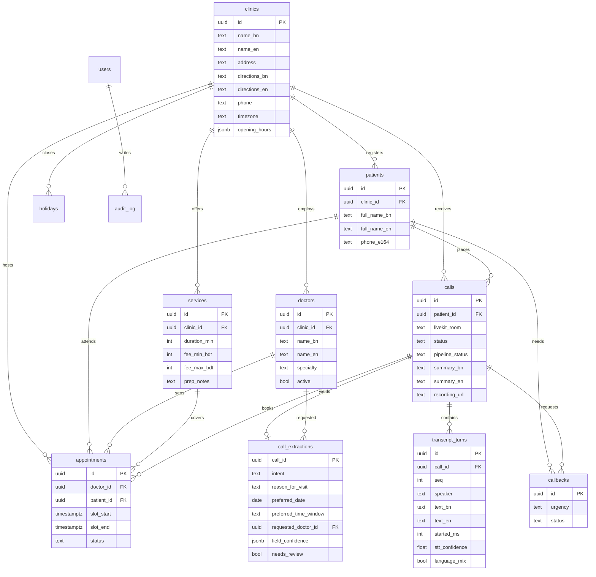

# Schema

ByteVoice stores one demo clinic, StrategyByte Dental Care. Primary keys are UUIDs. Timestamps are `timestamptz` and the clinic clock is `Asia/Dhaka`.

`calls.status` is the business outcome. `calls.pipeline_status` (`pending`, `running`, `done`, `failed`) is only there so the post-call job can run once. `transcript_turns.language_mix` records Bangla–English code-switching, which the live capture step asked for and the original column list did not name.

Active appointments (`booked`, `rescheduled`) cannot overlap for the same doctor. Postgres enforces that with a `btree_gist` exclusion constraint on `tstzrange(slot_start, slot_end)`.

Indexes: `calls(started_at)`, `calls(status)`, `patients(phone_e164)`, `appointments(doctor_id, slot_start)`, plus unique `(clinic_id, phone_e164)` and `(call_id, seq)`.

Phone numbers are stored as E.164 (`+8801XXXXXXXXX`). The spoken form groups the local number as `০১৭১২-৩৪৫-৬৭৮`. Each extracted field in `field_confidence` looks like `{ "confidence": 0.9, "source_turn_seq": 4 }`. Anything under 0.65, or a phone/date that fails validation, sets `needs_review`.
